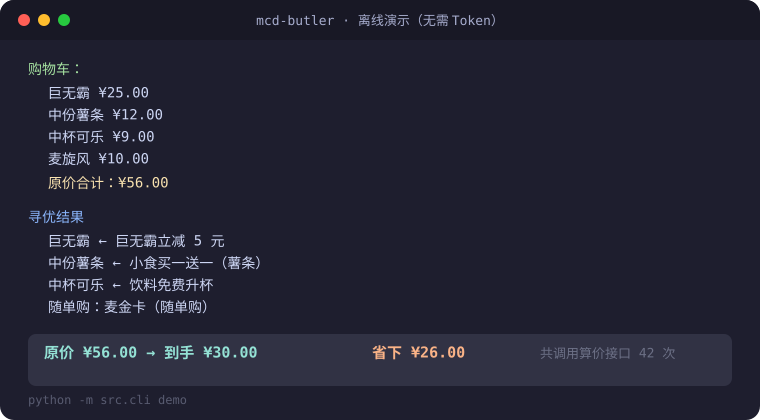

# 麦门管家 · mcd-butler

[](https://github.com/GenshinKings/mcd-butler/actions/workflows/ci.yml)    [](LICENSE)

**麦当劳永远不会告诉你，你手里这张券到底值多少钱。**

它只回答两个问题：**哪张券挂到哪件商品最划算；这一趟值不值得跑。**

> **MIT 开源 · 非麦当劳官方产品 · 不碰支付、不代下单，只读公开算价接口 · Token 只留在本机**
>
> 觉得这几条重要的话，完整的写在 [红线](#redline) 一节 —— 不用你翻到最底下。

券上印着「立减 8 元」，挂上去接口只给你减 5 块 —— 差的 3 块去哪了没人说得清，

因为算价接口只回一个总价，从不告诉你每张券各自贡献了多少。

麦门管家把每张券逐一挂到不同价位的商品上，真打一遍[麦当劳官方开放的 MCP 接口](https://open.mcd.cn/mcp)，把它的真实价值**试**出来：

```
── 券面额 ≠ 券价值 ──────────────────────────
  ! 安格斯厚牛堡立减 8 元　标着减 ¥8.00，实际只省 ¥5.00

── 看着挺猛，其实没用 ────────────────────────
  × 小食满 15 减 3 元（标着减 ¥3.00）
    门槛：满 ¥15.00（券面写的），便宜的东西够不到

── 门槛 ─────────────────────────────────────
  · 小食满 15 减 3 元
      门槛：满 ¥15.00（券面写的）
  · 满 20 减 3 元
      门槛：满 ¥20.00（券面写的）
```

门槛**券面写了就直接念券面**：「满 20 减 3 元」已经把门槛印在脸上了，
没必要再花两次算价去反推一个更粗的区间。只有券面没写门槛时，才靠
「便宜的挂不上、贵的挂得上」试出来，并且会明确标注那是试出来的。

<a id="hook"></a>

### 三行看完（不用账号、不用 Token）

```bash
git clone https://github.com/GenshinKings/mcd-butler.git
cd mcd-butler
python -m src.cli demo
```

`demo` 是**离线**的：不用注册、不用填 Token、不发一个网络请求，就能看到下面那一整屏。

看完再决定要不要继续。

<details>

<summary><b>在这一页里找东西</b>（这份 README 很长，先给张地图，点哪都能跳）</summary>

| 你想干嘛                              | 去这                                        | 大概几行 |
| --------------------------------- | ----------------------------------------- | ---- |
| 30 秒判断值不值得往下读                     | [三行看完](#hook) → [离线演示长什么样](#demo)         | 120  |
| 装到我电脑上（含 Windows / macOS / Token） | [三分钟跑起来](#install)                        | 150  |
| 查某个命令是什么意思                        | [全部 17 个命令](#commands)（中文名 ←→ 命令名对照）      | 25   |
| 想知道真能省多少钱                         | [真实账号实测](#realtest) · [省钱洞察](#insights)   | 100  |
| 确认它会不会偷我的东西                       | [红线](#redline)                            | 8    |
| 判断仓库是不是还活着                        | [校验与开发](#verify)（CI / 315 项自检 / 117 处变异测试） | 55   |
| 想晒一张卡片给朋友                         | [传播素材](#promo)（`brag --with-link` 一键生成）    | 10   |

不确定的话就顺着往下读 —— 顺序是按「最容易决定要不要走」排的。

</details>

<details>

<summary><b>觉得有用？顺手点个 ⭐；想转发？文案已经写好了</b></summary>

这个项目是给一个比赛做的，排名**只看 Star 数**。你点一下星，就是它唯一的成长方式。

想发朋友圈 / 微信群 / CSDN，不用自己写，三份都写好了（稿子只存在本地 `docs/`，没有随仓库公开 —— 仓库里这份 README 是给路人读的，稿子是给自己发的）：

- `docs/promo.md` —— 发朋友圈和群用的短版/长版文案、标题备选
- `docs/CSDN-麦当劳MCP实战.md` —— CSDN 长文
- `docs/微信公众号.md` —— 公众号稿

</details>

<details>

<summary><b>怎么做到的（不想看算法可以跳过）</b></summary>

把「券 ↔ 商品」建模成**二分匹配**，但算价接口是个黑盒 —— 它只回总价，不回导数，

没法直接求梯度。于是拿官方接口**当试价器**：贪心构造一个初始解，再用

换券 / 删券 / 换随单购档位三种邻域动作做局部搜索，在调用预算内收敛。

「够不够好」不是嘴上说的。离线自检里拿**穷举最优**当标尺去量它：

80 组随机购物车，命中率 **94%**（`selftest` 里是一条硬性断言，阈值低于 0.85 就红）。

</details>

> 📌 口径：App 展示的"已优惠"以含卡费的 `originalPrice` 为基准，
>
> 本项目一律以**裸买价**为基准，所以数字更保守 —— 不拿卡费给自己脸上贴金。
>
> 非麦当劳官方产品，不碰支付、不代下单，只读公开算价接口。

**不用账号也能先看：** 下面是 `python -m src.cli demo` 的真实输出（演示数据，非真实价格）。

> 演示**只有两段**，因为这两段才是人人都用得到的：
> 购物车 + 券 → 逐张试出真实价值 → 挂到最合适的那件 → 省了多少。
>   
> 其余是玩法向的（黄历 / 券包体检 / 活动日历 / 段位），`demo --all` 才跑，一共**六段**。

下面四段是 `demo --all` 多出来的（**录于 2026-10-13**）。

> **哪些行会变，先说清楚**（早先这里写「除了今天几号，其余每一行都能原样复现」，
> 那是假的——日历里「N 天后」是相对今天的，日期和星期会一起漂，连带星期几也变）：
> 黄历头一行的日期与星期、活动日历里的「今天 …」和「🆕 MM-DD（N 天后）」这四处
> 跟着你跑的那天走；**其余每一行**都能在你机器上原样复现。

**《麦门黄历》**——宜吃什么、忌吃什么，每条都真打过算价接口：

```
  麦门黄历 · 2026-10-13 周二 · 午市
  正餐时段，套餐券最全

  宜 · 中份薯条
      挂「小食买一送一（薯条）」→ 到手 ¥6.00（省 ¥6.00，力度 50%）

  宜 · 巨无霸
      挂「巨无霸立减 5 元」→ 到手 ¥20.00（省 ¥5.00，力度 20%）

  宜 · 麦辣鸡腿堡
      挂「汉堡类任选 -4 元」→ 到手 ¥18.00（省 ¥4.00，力度 18%）

  宜 · 中杯可乐
      挂「中杯可乐立减 3 元」→ 到手 ¥6.00（省 ¥3.00，力度 33%）

  忌 · 麦旋风
      「麦旋风满 20 减 1 元」挂券反而贵 ¥1.00
      这张券没到门槛、不会生效，却把原本的默认折扣顶掉了

  忌 · BFF四宫格小食盘双人餐
      标的 ¥62.90 是「随单购麦金卡优惠」价
      不满足条件要按 ¥122.50 结账，差 ¥59.60

  今天能省的都在上面了，不多，但都是真的 —— 小的不编。
  （每条宜忌都在演示数据上算过价；为让输出可复现，
  演示把时间钉在当天 12:00，所以这里写的「午市」不一定是你现在的时段。
  真实门店跑 `python -m src.cli almanac`）
```

> 「宜」= 挂上去接口真给我便宜了这么多；「忌」= 没券可挂、**挂上去反而更贵**，
>
> 或者菜单上那个诱人的低价其实是条件价。

**《券包体检》**——你手里每张券，在这家店到底值多少钱：

```
  券包体检 · 演示餐厅·二号店（另一套券池）

  在售 4 件 · 券池 5 张 · 本次体检 5 张

  真能省钱   3 张
  挂了白挂   1 张
  无处可挂   1 张

  健康度 ████████████░░░░░░░░ 60%
  （健康度 = 真能省钱的 3 张 ÷ 体检到的 5 张；
  挂了白挂和在这家店无处可挂都算不健康）

  ── 最值钱的券
  ¥5.00  安格斯厚牛堡立减 8 元
        挂「安格斯厚牛堡」 ¥25.00 → ¥20.00
  ¥4.00  板烧鸡腿堡立减 4 元
        挂「板烧鸡腿堡」 ¥18.00 → ¥14.00
  ¥3.00  满 20 减 3 元
        挂「安格斯厚牛堡」 ¥25.00 → ¥22.00

  ── 门槛
  · 小食满 15 减 3 元
      门槛：满 ¥15.00（券面写的）
  · 满 20 减 3 元
      门槛：满 ¥20.00（券面写的）
```

**《择日》**——官方活动日历是有的，只是没人把它跟「我今天要不要吃」放在一起看：

```
  麦门活动日历
  今天 2026-10-13 周二

  今天有 2 个活动
    · 超值𝟡.𝟡元早餐两件套陪你开工啦　¥9.90
      早八的快乐，一堡一咖已就位
    · 学生专属！49元150天麦金学期卡　¥49.00
      每天低至 0.33 元，一卡在手

  接下来 7 天，1 天有今天吃不到的新活动：
    🆕 10-16 周五（3 天后）　最低 ¥12.90
      麦麦夜市回归

  价格取自活动文案自己写的数字；没写的显示「未标价」，不猜。
  今天 2 个活动，最低 ¥9.90：超值𝟡.𝟡元早餐两件套陪你开工啦
  　10-16（3 天后）「麦麦夜市回归」（最低 ¥12.90） —— 今天没有这天才有，等不等你自己定

  （演示报文，结构照搬真实返回；真实门店跑 `python -m src.cli campaign`）
```

> 只提示**今天吃不到的新活动**。今天就能买的东西劝你干等，那不叫建议，叫拖延。

真实门店（需 Token）跑 `advise` / `audit` / `campaign` / `almanac`，一次给你完整结论。

---

<a id="install"></a>

## 三分钟跑起来

零第三方依赖（只用 Python 标准库），需要 **Python 3.10 以上**。

（**不用 pip install 任何东西** —— 这是刻意的，clone 下来就能跑。

后面第 ② 步末尾有个 `pip install -e .`，那是**可选**的：不装也能用，装了只是多一个

`mcd-butler` 命令入口，让你在任何目录都能直接敲它。）

**⓪ 先确认你有 Python**（没装过的先看这段）

```bash
python --version        # 应该打印 Python 3.10.x 或更高
```

- 打印了版本号 → 跳过这一节，直接往下走
- 提示「不是内部或外部命令」/ `command not found` → 去 <https://www.python.org/downloads/>

  下载安装包。**Windows 用户安装时务必勾选 `Add Python to PATH`**（安装界面最下面那个框），

  否则装完命令行还是找不到它。装完重开一个命令行窗口，再敲一次 `python --version` 确认。
- 系统里是 `python3` 而不是 `python` → 把下面所有命令里的 `python` 换成 `python3` 即可

**① 拿到代码**（两种都行，挑你会的那个）

```bash
git clone https://github.com/GenshinKings/mcd-butler.git
cd mcd-butler
```

不想用 git：点仓库页面绿色的 **Code** 按钮 → **Download ZIP** → 解压，

然后在解压出来的文件夹里打开命令行。

**② 先看效果，不用账号、不用联网**

```bash
python -m src.cli demo        # 离线演示
python -m src.cli selftest    # 离线自检，315 项，几秒跑完（全绿才算跑通）
```

> ⚠️ 上面这些命令**必须在项目文件夹里执行**。
>
> 在其他目录会报 `No module named 'src'`——先 `cd` 进来就好了。
>
> `selftest` 跑完如果**不是全绿**，把最后的红条发到 Issues —— 那是真 bug，不是你装坏了。

想在任何目录都能用（可选，不装也不影响上面任何一步）：

```bash
pip install -e .     # 零依赖，装出来的只是一个命令入口
mcd-butler demo      # 之后任意目录都可直接调用
```

**③ 接自己的账号（可选，但接了才算真省钱）**

到 <https://open.mcd.cn/mcp> 用你的麦当劳会员账号登录、激活，页面上会给一串 Token

（一长串字母数字，复制下来即可）。拿到之后二选一：

```bash
# Linux / macOS
export MCD_MCP_TOKEN=你的Token

# Windows（PowerShell —— Win11 默认终端就是它）
$env:MCD_MCP_TOKEN="你的Token"

# Windows（CMD）
set MCD_MCP_TOKEN=你的Token
```

> ⚠️ 上面这两种写法**只在当前这个命令行窗口有效**，关掉窗口就没了，下次要重敲。
>
> 想一劳永逸就写进 `.env`（见下）。

也可以把 Token 写进项目文件夹里的 `.env` 文件（程序会自动读它，`.env` 不会被提交进仓库）。

**Windows 资源管理器不允许新建以点开头的文件名**，所以用命令行建：

```bash
# Linux / macOS / Windows PowerShell 通用
python -c "open('.env','w',encoding='utf-8').write('MCD_MCP_TOKEN=你的Token')"
```

文件内容就一行：

```
MCD_MCP_TOKEN=你的Token
```

**这个 Token 能干什么、不能干什么**（很多人到这一步会犹豫，说清楚）：

- ✅ **只能查询**：查附近门店、查菜单、查你卡包里的券、试算价格
- ❌ **不能下单、不能付款**：代码里没有任何下单和支付调用，

  你可以自己验：在 `src/*.py` 里搜 `create-order`，一次调用都搜不到

  （`FINDINGS.md` 里提到它，那是在记「这个工具存在但我们没用」，不是调用）
- 🔒 **不出你的电脑**：Token 只存在你本机，不上传，也不上传你的消费记录
- 🔑 不想用了，去 <https://open.mcd.cn/mcp> 重新生成一个，旧的立刻失效

接过 Token 之后，一条命令就能把今天的事盘清楚：

```bash
python -m src.cli advise
python -m src.cli advise --items "板烧鸡腿堡三件套,薯条x2"
```

**不给 `--items` 时，它不会替你点菜。** 它会先提醒今天就要作废的券（这个比省几块钱更急），
再把你手里每张券在这家店盘一遍——各值多少钱、挂在哪个商品上最值——然后请你自己说想吃什么。

为什么不替你挑：早先它会从菜单里取前几个「有券覆盖」的商品凑成一单，打印成「推荐这一单」。
那不是推荐，是替你做决定，凑出来的往往是你根本不想吃的东西。管家不该这么办事。
给了 `--items`，它才按你那一单算最优挂法。

还没想好吃什么，就先看黄历：

```bash
python -m src.cli almanac      # 今天宜吃什么、忌吃什么（每条都真算过价）
python -m src.cli brag         # 我的麦门账本与段位（读本机快照，无需 Token）
```

有 Token 之后，想吃什么自己点：

```bash
python -m src.cli menu --filter 堡                      # 先看菜单
python -m src.cli optimize --items "板烧鸡腿堡三件套,薯条x2,脆薯饼"
python -m src.cli compare --items "板烧鸡腿堡三件套" --mode taxi  # 该去哪家店、值不值得跑
python -m src.cli audit                                # 券包体检：每张券真实值多少钱
python -m src.cli campaign                             # 活动日历：今天有什么活动、哪天有新品
python -m src.cli meal --name 三件套                    # 这套餐能换成什么、换哪个更便宜
```

<a id="commands"></a>

### 全部 17 个命令（中文名 ←→ 命令名）

| 我想干什么                         | 命令          | 要 Token 吗 |
| ----------------------------- | ----------- | --------- |
| 先看看效果（离线，什么都不用配）              | `demo`      | 不要        |
| 跑作者给自己留的 315 项检查              | `selftest`  | 不要        |
| 看我的麦门账本和段位                    | `brag`      | 不要        |
| 删掉本机账本里记错的一笔（**不动会员账号、不解绑**）  | `forget`    | 不要        |
| 今天该怎么点（得先告诉它你想吃什么）            | `advise`    | 要         |
| 今天宜吃什么忌吃什么                    | `almanac`   | 要         |
| 我每张券在这家店值多少钱                  | `audit`     | 要         |
| 今天有什么活动、哪天有新品                 | `campaign`  | 要         |
| 看门店菜单                         | `menu`      | 要         |
| 指定我要买什么、怎么挂券最省                | `optimize`  | 要         |
| 该去哪家店、跑一趟值不值                  | `compare`   | 要         |
| 我卡包里有什么券、积分多少、这点积分能换什么       | `assets`    | 要         |
| 麦乐送（外送）这条链路现在通不通、卡在哪一步       | `delivery`  | 要         |
| 套餐能换成什么、换哪个更便宜                | `meal`      | 要         |
| 上次那单今天再买要多少钱（**只重新算价，不会真下单**） | `replay`    | 要         |
| 给我一个热量额度，在这个额度内帮我搭配（不是列热量表）   | `nutrition` | 要         |
| 列出 MCP 提供了哪些工具                | `tools`     | 要         |

> `almanac` = 黄历，`brag` = 晒，`assets` = 你账号里的资产（券 + 积分），
>
> `audit` = 体检，`campaign` = 官方活动。名字是英文的，中文名在输出里会印出来。

---

<a id="demo"></a>

## 离线演示长什么样


*上面是真实录屏 —— `python -m src.cli demo` 的完整输出一屏放完，由 [`scripts/demo.tape`](scripts/demo.tape) 录制，脚本入库，任何人都能重录一遍验证，不存在"截图 P 过"的疑问。下面是同一份输出的高清静态版：*



```
麦门管家 · 离线演示（无需 Token · 演示数据）
----------------------------------------------

购物车
  巨无霸    ¥25.00
  中份薯条  ¥12.00
  中杯可乐  ¥9.00
  麦旋风    ¥10.00
  合计      ¥56.00

可用券（5 张）
  巨无霸立减 5 元       适用 巨无霸
  汉堡类任选 -4 元      适用 巨无霸、麦辣鸡腿堡
  小食买一送一（薯条）  适用 中份薯条
  中杯可乐立减 3 元     适用 中杯可乐
  麦旋风满 20 减 1 元   适用 麦旋风

怎么挂最省（演示数据上逐张试算，不是真实门店的价格）
  巨无霸    ¥25.00  ← 巨无霸立减 5 元       → ¥20.00
  中份薯条  ¥12.00  ← 小食买一送一（薯条）  → ¥ 6.00
  中杯可乐  ¥ 9.00  ← 中杯可乐立减 3 元     → ¥ 6.00
  麦旋风    ¥10.00  ← 没挂券                → ¥10.00
  ----------------------------------------------
  挂券后小计 ¥42.00
  随单购「麦金卡（随单购）」再减 ¥6.00（卡费另算）
  ----------------------------------------------
  原价 ¥56.00 → 到手 ¥36.00，省下 ¥20.00
  其中 ¥6.00 是随单购带来的，卡费还没扣进去（不随单购是 ¥42.00）

复刻上一单（同样的单，今天再买多少钱）

  07-14 · 麦门管家·演示餐厅
    巨无霸 ×1          当时 ¥24.00 → 现在 ¥25.00
    中份薯条 ×1
    中杯可乐 ×1
    上次实付 ¥33.00 → 今天 ¥26.00，便宜了 ¥7.00
    （用了 3 张券 + 麦金卡（随单购））

  09-02 · 麦门管家·演示餐厅
    麦辣鸡腿堡 ×1
    麦旋风 ×1
    上次实付 ¥30.00 → 今天 ¥26.00，便宜了 ¥4.00
    （用了 0 张券（另有 1 张挂了但被随单购抵消，没减到钱） + 麦金卡（随单购））

  就这两段：把购物车和券丢进来，算出怎么挂最省。
  还有黄历 / 券包体检 / 活动日历 / 段位，想看就跑：
    python -m src.cli demo --all
```

> 分项能加出总价，是刻意的。早先屏幕上只有「原价 ¥56.00 → 到手 ¥36.00」，
>
> 读者按菜单价自己加出来是 ¥42.00，中间那 ¥6.00 没有任何一行解释 ——
>
> 那是最劝退的一种失败：不是工具算错，是它没把账摊开给你看。

> 上面就是 `python -m src.cli demo` 的**完整输出**（演示数据，不代表真实价格）——
>
> 刻意只有两段：演示堆料等于没演示，先把「券挂到哪件最省」这条主线讲完。
>
> 想看玩法向的四段（黄历 / 券包体检 / 活动日历 / 段位）就跑 `demo --all`。
>
> 截图由 `python scripts/render_terminal_svg.py` 从真实 stdout 渲染生成——
>
> 改了引擎输出就重跑一次，文档不会和代码脱节。录屏同理由 `vhs scripts/demo.tape`
>
> 录制（需装 [vhs](https://github.com/charmbracelet/vhs)），录完用 ffmpeg 压一遍体积。

---

<a id="realtest"></a>

## 真实账号实测

```bash
export MCD_MCP_TOKEN=<你的 Token>
python -m src.cli optimize --city 上海 --keyword 人民广场
```

不加 `--items` 时会自动挑一张购物车（优先纳入券覆盖到的商品，  
否则随机挑的话大概率一张券都用不上，引擎就退化成"啥也没优化"）。  
想指定吃什么就用 `--items`，支持数量：

```bash
python -m src.cli optimize --items "板烧鸡腿堡三件套,薯条x2,脆薯饼"
```

品名对不上会明确告诉你哪几个没匹配到，并提示用 `menu --filter` 查准确品名，  
不会拿一个不相干的商品凑数。

```
定位门店：上海 / 人民广场 → 1450713（华旭国际大厦餐厅）
菜单载入 68 个品类     门店可用券 1 张

购物车（优先纳入券覆盖到的商品）：
  - 麦咖啡™美式         ¥19.00   ← 标价 ¥9.90 需随单购麦金卡，否则按 ¥19.00
  - 脆薯饼              ¥8.50
  - 【美汁源】"黄金橙橙"  ¥13.00
  - 龙焰鸡腿堡四件套     ¥57.00   ← 标价 ¥29.00 需随单购麦金卡，否则按 ¥57.00

最优组合：
  麦咖啡™美式  ←  9.9元中杯冰美式
  随单购：随单购麦金卡优惠

裸买价 ¥97.50  →  到手 ¥70.30
真实省下 ¥27.20（接口 discount 报 ¥37.10，含卡费口径）
算价接口共调用 4 次
```

> 这段是 **2026-10-11 的真实记录**，原样保留没改。现在跑 `optimize` 已经不打印最后那行「算价接口共调用 N 次」了 ——
>
> 调用次数是内部指标，你关心的是「这是不是最优」：只有预算没跑完时才提示一句
> 「不保证没有更便宜的，加 `--budget` 可试更全」。不撒谎说自己找到了最优解。


这一跑暴露出三个只有真跑才能发现的事实，也正是本项目存在的理由：

1. **菜单标价是条件价**。四件套货架上写 ¥29，`currentPrice` 确实是 29，但 `discountType` 是「随单购麦金卡优惠」——不随单购就按 `originalPrice` ¥57 结算。差 ¥28。
2. **省了多少不能信 `discount`**。随单购会把**卡费算进 `originalPrice`**（97.50 → 107.40，多出的 9.90 就是卡费），于是 `discount` 报 37.10，而用户真正省的是 97.50 − 70.30 = **27.20**。本项目统一以裸买价为基准。
3. **券会互相作废**。随单购之后美式已是 ¥9.9，那张「9.9 元冰美式」券就冗余了（实测：用券与不用券都是 ¥70.30）。引擎会自动识别这种冗余，不再把券硬塞进去。

> **可复现数据**：同一单真实节省 **27.9%**（裸买 ¥97.50 → 到手 ¥70.30；  
> 这是单笔示例订单，不同订单省幅不同，普通单可能只省几元）；  
> 离线自检把「穷举最优」当标尺，80 组随机购物车里求解器命中 **94%** 的最优组合  
> （自检断言阈值为 ≥85%；94% 与下面那个平均差都是固定种子跑出来的实测值，不是挑好看的说的 ——
> 命中率由自检反向钉住：引擎改了而 README 没改，自检立刻翻红。差距平均 ¥0.26，且绝不超 `--budget` 调用上限）。

---

## 为什么不是"挑一张最猛的券"

麦当劳的 `calculate-price` 允许购物车里**每个商品各自挂一张券**。所以这个问题不是「选一张券」，而是一个**二分匹配**：

```
约束 1：一张券最多用一次
约束 2：一个商品最多挂一张券
约束 3：券只能挂到它 products[] 里声明过的商品上
```

难处在于：**接口不返回券的折扣金额**，只有标题和适用商品。收益无法离线估算，公式派不上用场。

所以本项目把 `calculate-price` 当作**黑盒求值器**，用搜索求解：

1. **贪心构造** — 按可挂商品数升序安排券，最受约束的先占坑
2. **局部搜索** — 交替执行 删除 / 新增 / 交换 三种邻域动作，每步都用真实接口验证，只接受变便宜的改动
3. **预算收敛** — 调用次数达上限或不再改进即停（默认 40 次，接口限流 600 次/分钟）

这比穷举更贴近真实约束：调用次数可控，且不依赖任何未在文档中承诺的字段。

代码在 `src/coupon_engine.py`，求解器接受可注入的 `oracle`，因此离线演示能完整复现搜索过程。

---

## 接真实账号

```bash
export MCD_MCP_TOKEN=<在 https://open.mcd.cn/mcp 激活得到的 Token>
python -m src.cli optimize --city 上海 --keyword 人民广场
python -m src.cli tools        # 列出官方暴露的全部 35 个工具
```

真实链路已实测跑通：定位门店 → 载入菜单（实测 68 项）→ 拉门店可用券 → 算价寻优。

> 卡包为空时 `optimize` 会提示先领券，此时离线演示仍可正常查看。

踩坑记录另见 [`FINDINGS.md`](./FINDINGS.md)。

---

<a id="insights"></a>

## 省钱洞察：钱是怎么省下来的

```bash
python -m src.cli optimize --items "板烧鸡腿堡三件套,薯条x2"   # 默认带洞察
python -m src.cli optimize --no-insights                      # 跳过，快一些
```

### 每件东西的真实成本

标价是标价，实际花掉多少是另一回事。做法是**逐件剔除再重新寻优**——  
少了一件之后，最优的券搭配可能整个变了，所以不能原样搬券，必须重算。

### 哪张券挂了等于没挂

判据很直白：把这张券摘掉，总价一分不变，那它就是摆设。  
实测里最典型的成因是随单购已经把商品降到券面价了，此时再挂券一分钱也不会再减。

### 分开下单会不会更便宜

一张券通常只能用一次，整单结算时可能被迫「二选一」，拆成两单说不定两张都用得上。  
这里只试「单件独立成单」这一种拆法——完整枚举所有分割是 2^n，调用次数会爆，  
而单件拆出已经覆盖了绝大多数真实受益场景。

---

## 资产巡检：券的保质期比你想的短

```bash
python -m src.cli assets           # 只读，绝不领券
python -m src.cli assets --claim   # 显式加参数才真领（会写进你的真实会员账号）
```

真实账号实测输出：

```
## 积分
- 可用：**9.9** 麦享会积分
- 累计：9.9　已用：0

## 卡包（5 张）
- 🚨 **2 张今天内到期** —— 不用就作废：
  - 巧克力味厚松饼猪柳蛋套餐　2026-10-11 05:00-2026-10-11 10:29
  - 人气麦旋风买一送一　2026-10-05 00:00-2026-10-11 23:59
- ✅ 3 张仍可用：
  - 9.9元中杯冰美式　2026-10-11 00:00-2026-10-17 23:59　还剩 6 天　[到店专用、外送专用]
  ...
```

顺带一个真实的坑：领了 6 张券，但门店券池里**只剩 1 张能用** —— 其余是早餐/小食时段券，  
在非早餐时段自动失效。这就是「券迷宫」的体感来源：你以为你有 6 张券，其实此刻能用的只有 1 张。

**默认只读**是硬约束：领券会写进真实会员账号，所以必须显式加 `--claim` 才执行。

---

## 复刻上一单：这单变贵了还是变便宜了

```bash
python -m src.cli optimize                     # 跑完自动存快照
python -m src.cli replay                       # 按今天的菜单和券重算一遍
python -m src.cli replay --list                # 列出历史快照
```

```
复刻来源：本地快照 2026-10-11 01:07
目标门店：1450713
复刻购物车：麦咖啡™美式 / 脆薯饼 / 黄金橙橙 / 龙焰鸡腿堡四件套

上次实付 ¥70.30  →  今日最优 ¥70.30
同样的单，持平 ¥0.00
```

比较口径统一为**「上次实付」vs「今天同款的最优实付」**。  
不能用「上次实付」比「今天菜单标价」——那是拿用券后的价格去比不用的价格，自己在骗自己。

### 为什么需要本地快照

`order-list` 对不少账号返回的是空的 `data: {}`。如果你的账号从没在麦当劳下过单  
（比如住处附近没有门店），那这个接口**永远**是空的，「复刻历史订单」就无从谈起。

所以换了思路：**上一次算过的那单，就是你的上一单。**  
`optimize` 跑完把购物车和成交价存一份到 `~/.mcd-butler/`（不进仓库，属个人数据），  
下次 `replay` 时拉今天的菜单和券重算。账号一旦有真实订单，自动优先用真实订单。

---

## 热量预算搭配

```bash
python -m src.cli nutrition --kcal 600
```

```
门店：麦当劳上海黄浦华旭国际大厦餐厅
菜单 68 个品类
营养表 158 条（接口返回的是字符串，需自行解析）
能对上营养数据的餐品 24 个

热量预算 600 kcal 内推荐搭配（按蛋白质降序）：

  1. 浓缩咖啡 + 薄皮焦香V翅 + 板烧鸡腿堡
     596 kcal　蛋白 41.0g　脂肪 28.0g　碳水 43.0g　钠 1635mg
     合计 ¥54.50
```

为什么按蛋白质排序而不是按热量：减脂的诉求是「热量有上限，但不能饿」。  
纯按热量排会选出一份沙拉配零卡可乐，那不叫搭配。

`list-nutrition-foods` 的返回值得单独说一句：`success=true`，  
但 `data` 是**一个字符串**——整张表塞在类 CSV 里，首行 `[160]{字段清单}:` 声明条数与结构  
（声明 160 条，能按字段完整解析出来的是 158 条 —— 差的按解析不出来处理，直接丢）。  
而且**营养表里没有 `productCode`**，只能按品名和菜单匹配，匹配不上就丢弃，  
宁可少选也不能拿错数据给建议。

---

## 麦门黄历：今天该吃什么，别吃什么

```bash
python -m src.cli almanac
```

券价引擎回答的是「**这一单**怎么买最便宜」，可多数人早上打开 App 时脑子里还没有一单，

只有一句「今天吃点啥」。黄历回答的就是这一句。

设计上有一条硬规矩：**不编**。每一条宜忌背后都真的打过 `calculate-price`：

| 黄历条目       | 依据                                         | 是否额外调接口     |
| ---------- | ------------------------------------------ | ----------- |
| 宜 · 某单品    | 裸买价 − 挂券价，差值为正                             | 是（每件 ≤ 2 次） |
| 忌 · 挂券反而更贵 | 差值为负，多半是随单购把卡费算进来了                         | 是           |
| 忌 · 条件价陷阱  | 菜单 `currentPrice` vs `originalPrice` 的真实差额 | 否（零成本）      |
| 忌 · 无券可挂   | 该单品不在任何券的适用范围                              | 否           |

几个必须说清楚的取舍：

- **时段先说在前头**：麦当劳大量券是时段券（早餐/夜宵），

  所以黄历第一行就写「早市 / 午市 / 下午茶 / 晚市 / 夜宵」——

  推荐一张 10:31 就失效的早餐券，等于骗人。
- **一件商品只留最省的那条券**：巨无霸能挂两张券时，黄历讲「今天该吃什么」，

  不是券清单，重复列出反而看不清。
- **券挂不上就直说**：这家门店当前一张券都挂不上时，

  黄历只输出菜单本身的价格陷阱，并明确标注「不是完整的宜忌」。

  宁可少给，也不拿原价凑成一条「忌」。
- **临期券单独喊出来**：今天/明天到期的券会被点名，作废比花错更可惜。

---

## 麦门段位：省钱是能攒的

```bash
python -m src.cli brag        # 读本机快照，不联网、不需要 Token
```

```
  累计测算可省   ¥94.50　　共 15 次测算
  ⚠️ 其中 0 笔是真实成交 —— 这是「这么点能省多少」，不是已经省下的钱。
  最常光顾   麦当劳上海黄浦华旭国际大厦餐厅
  最常用券   9.9元中杯冰美式
  记账起始   2026-10-11

  当前段位   麦门路人  ░░░░░░░░░░░░
             刚进门，还没尝到甜头　（按真实成交累计实付算，测算不涨段位）
  想升段位，得先有真实成交：`python -m src.cli replay` 导入您的历史订单。

┌──────────────────────────────────┐
│   麦 门 管 家 · 我 的 麦 门 账 单   │
└──────────────────────────────────┘
  段位：麦门路人
  累计测算可省：¥94.50
  经手：15 次测算 / 0 笔真实成交
  最常光顾：麦当劳上海黄浦华旭国际大厦餐厅
  最常用券：9.9元中杯冰美式
  记账起始：2026-10-11
```

（上面是作者本机账本的真实输出 —— 你的数字当然是你自己的。  
注意那句 `⚠️ 其中 0 笔是真实成交`：**没真下单就不算真的省了钱**，只算「这么点能省多少」。）

段位共 7 档（麦门路人 → 学徒 → 信徒 → 执事 → 主教 → 大主教 → 麦门永存）。

**段位只按真实成交的累计实付金额晋升，测算一分不涨。** 这不是保守：
早先段位按「累计省下」算，而 `optimize` 默认每次都记账 —— 同一单跑 15 次
就是「省了 ¥94.50、麦门信徒」，卡片发出去是一张自己都圆不上的假成绩单。
真实成交来自 `replay` 导入的历史订单，按**订单号的哈希**去重
（订单号原文不落盘 —— 它能反查到手机号和支付流水），所以跑十遍也只算那几笔。

顺带一提：作者这个账号在麦当劳从没下过单（`order-list` 是空的），
所以上面那段位就是路人 —— 这正说明它刷不动。

数据全部来自本机快照 `~/.mcd-butler/`，不联网、不上传 ——
一个省钱工具去上传你的消费记录，那才是真离谱。

卡片是纯文本的，可以直接粘进朋友圈和群里。**省钱这件事，能跟朋友说的那一刻才有快感。**

---

## 该不该跑这一趟：多门店比价 + 路程性价比

券引擎只回答「这单最省几块」，它默认**去这家店是免费的**。  
现实里不是：门店离你 144 米和 3 公里，是两种完全不同的决策。

```bash
python -m src.cli compare --items "龙焰鸡腿堡三件套,美式" --top 3
python -m src.cli compare --mode taxi --wage 60        # 打车 + 把等待折算成钱
```

真实输出（上海人民广场，接口返回的 `distance` 为真值）：

```
出行方式：打车（400 米/分，起步 ¥14.00，每公里 ¥2.50，另计 5 分钟进出店开销）

门店                              距离      来回       到手价       路费        综合
麦当劳上海黄浦华旭国际大厦餐厅      144m      6分    36.80   14.72    57.52
麦当劳上海福州路餐厅               235m      6分    36.80   15.18    57.98
麦当劳上海食品一店餐厅             355m      7分    36.80   15.78    59.58

综合算下来去「麦当劳上海黄浦华旭国际大厦餐厅」最划算。
⚠️ 提醒：这趟路费 ¥14.72 ≥ 券省下的 ¥2.00，等于白跑 —— 除非你本来就要出门。
```

几个设计取舍：

- **距离是真值，不是估算**：`query-nearby-stores` 实测返回 `distance`（米），  
  到店门店和得来速都有。路程模型只负责把米换算成分钟和钱。
- **缺货的店不参与排序**：拿「有货的店」和「缺货的店」比价是不公平比较，  
  缺货店单独列出但不进入排名。
- **打烊的店直接剔除**：推荐一家已经关门的店是硬伤，不是"排序靠后"能弥补的。  
  `businessStatus` 实测为布尔值；字段缺失时不敢乱猜，按营业处理。
- **时间值不值钱由你决定**：`--wage` 给了才把等待折成钱，  
  不给就只按真金白银排 —— 工具不该替用户决定 15 分钟值多少钱。
- **到店是真值，外送要看地址**：外卖（麦乐送）的价格 = 餐品外送价 + 配送费 +
  打包费，三项都得绑定**收货地址**才取得到。没有地址的账号（作者这台就是）
  确实算不了 —— `python -m src.cli delivery` 会把卡在哪一步说清楚，
  而不是拿一个猜的配送费凑数给你。

---

<a id="redline"></a>

## 红线

- Token 只走环境变量，不入库、不打印
- `calculate-price` 只算价；`create-order` 只到支付链接，**绝不触碰支付环节**
- 非商业：不售卖、不付费分发、不引流变现
- 本项目为参赛作品，**非麦当劳官方产品**；餐品信息、价格与供应状态以官方渠道实时结果为准

---

## 路线图

- [x] MCP 客户端与真实链路打通
- [x] 券价最优组合引擎（贪心 + 局部搜索）
- [x] 离线演示数据层
- [x] 资产巡检：卡包到期预警 + 积分过期提醒（默认只读）
- [x] 历史订单 replay（真实 `order-list` + 本地快照双数据源）
- [x] 随单购档位（麦金卡等）自动选档，并把「券省了多少 / 卡省了多少」分开报
- [x] 减脂模式：`list-nutrition-foods` 热量预算搭配
- [x] 自选购物车（`--items`，支持数量）与菜单浏览（`menu`）
- [x] 省钱洞察：真实成本 / 冗余券检测 / 拆单建议
- [x] 一键顾问 `advise`（到期提醒 + 每张券值多少 + 你指定商品后的最优挂法；**不替你点菜**）
- [x] 离线自检 `selftest`（315 项，覆盖三种返回体格式、接口异常结构守卫、匹配回归、路程模型、黄历与段位、随单购 payload、抖动不降级、体检与活动日历解析、餐品详情换项差价、传输层错误归类与退避、演示与 README 的一致性）
- [x] 变异测试 `scripts/mutate.py`：故意把 117 处核心逻辑改坏，自检必须逐条翻红（自检全绿不等于自检有效）
- [x] 多门店比价 + 路程性价比 `compare`（距离取接口 `distance` 真值）
- [x] 麦门黄历 `almanac`（每条宜忌都真打过算价，含条件价陷阱与时段判定）
- [x] 麦门段位与可晒账单 `brag`（读本机快照，不联网）
- [x] 券包体检 `audit`（券面额 vs 真实价值、废券/死券、试出来的门槛、到期倒计时）
- [x] 活动日历 `campaign`（只提示今天吃不到的新活动，不劝人为已有活动干等）
- [x] 餐品详情 `meal`（套餐由哪几件组成、换一样的差价，并单独挑出「换过去反而更便宜」的项）
- [ ] 定时领券（配合系统 cron / 计划任务）
- [x] 麦乐送链路体检 `delivery`（只读）：查收货地址、说明卡在哪一步；**有地址后的门店/价格测算仍未做** —— 作者账号无地址，取不到真值，不做估算
- [ ] 麦金卡权益雷达：活动规则变动解读

---

---

## 代码地图

```
src/
  mcd_client.py      MCP 客户端（Streamable HTTP，零第三方依赖）
  coupon_engine.py   券价最优组合引擎 ← 项目核心
  demo_data.py       离线演示数据层（无需 Token 即可完整演示）
  assets.py          资产巡检：卡包到期预警 + 积分过期（默认只读）
  snapshot.py        本地订单快照（~/.mcd-butler/，不进仓库）
  nutrition.py       热量预算搭配（解析类 CSV 营养表）
  insights.py        省钱洞察：真实成本 / 冗余券 / 拆单建议
  route.py           路程性价比模型：距离 → 时间 + 钱，多门店比价排序
  oracle.py          calculate-price 的唯一构造处（随单购 payload 只在这里拼）
  audit.py           券包体检：每张券的真实价值、废券与试出来的门槛
  campaign.py        活动日历：今天有什么活动、哪天有今天吃不到的新品
  almanac.py         麦门黄历：宜忌条目，每条都由真实算价支撑
  meal_detail.py     餐品详情解析：套餐组成、换项差价
  persona.py         麦门管家人格层：段位、口吻、晒单卡片
  selftest.py        离线自检（真实报文 fixture，无需 Token）
  cli.py             命令行入口

命令（17 个）：demo / selftest / tools / advise / audit / campaign / almanac / menu /
              optimize / compare / brag / forget / assets / nutrition / replay / meal / delivery

FINDINGS.md          35 个工具实测避坑笔记 ← 调麦当劳 MCP 前建议先看
MCP_INTEGRATION.md   使用的 MCP Server、Tool、调用流程与业务价值
```

<a id="verify"></a>

## 校验与开发

每次 push 都会自动跑一遍下面的前三项 —— 徽章是绿的，说明**在你 clone 的这一刻**，

这几件事在 3.10 / 3.13 × Linux / Windows 四种组合下都被真跑过一遍了。

```bash
python -m src.cli selftest            # 315 项离线自检，几秒
python -m src.cli selftest --twice    # 连跑两轮并比对断言总数（证明自检本身可重入）
python -m src.cli demo                # 离线演示，这是路人的第一印象
python scripts/smoke.py               # 编译 / 3.10 兼容 / 自检 / 演示 / 17 个命令 --help / 四种代码页
python scripts/mutate.py              # 变异测试：改坏 117 处核心逻辑，自检必须翻红
python scripts/check_links.py --online  # 链接体检：README 里写得出的每个链接都得点得到
                                        # 本机代理不可用时加 --proxy http://127.0.0.1:7897
```

<details>

<summary><b>CI 具体验什么、为什么跑这几样</b></summary>

CI **刻意不调麦当劳接口**：Token 走 secret 会把真实账号暴露给每一个 fork 的 PR，

那是合规红线。所以 CI 验的全是「不联网也能验」的事 —— 而恰好这几件事，

才是决定一个陌生人 clone 下来能不能跑通的东西。

| 步骤                 | 在防什么                                                                   |
| ------------------ | ---------------------------------------------------------------------- |
| `compileall`       | 有人写了 3.11+ 语法，本地 3.13 跑得欢，别人 3.10 直接 SyntaxError                       |
| `selftest`         | 麦当劳改一次返回体格式，解析器**静默失效** —— 本地跑得通，clone 的人跑不通                           |
| `selftest --twice` | 结果列表没清空时污染会同时放大分子分母，打印出来仍是「N/N 全绿」                                     |
| `demo`             | 这是 README 叫人跑的第一条命令，它挂了等于仓库是坏的                                         |
| 矩阵 4 组合            | Windowsrunner 默认代码页是 cp1252，`¥ ═ ❌` 这类字符会直接崩。**这一行是专为 Windows 中文用户留的** |

</details>

`mutate.py` 是这个项目最不一样的一条约束：**自检全绿不能证明自检有效。**

第一轮把 60 处核心逻辑逐个改坏，其中 33 处改坏后自检依然全绿 —— 那些断言守的是运气，

不是行为。补完断言后又自造了 10 处新变异，其中 8 处照样毫无反应；

把「改坏 → 跑自检 → 数变红条数」固化成一条命令之后，这 117 处变异才做到

每一处都至少有一条断言跟着翻红。

两条从这条约束里长出来的做法，值得单独说：

- **埋在函数内部、离线测不到的逻辑，要抽成纯函数。** 429 的退避时长原本写在

  重试循环里，想断言它得真发一次 HTTP 再挂钟计时 —— 没人会写，于是「退避改回

  0.5 秒」改坏了也不会红。抽成 `_backoff_for()` 之后可以直接断言数值。
- **`--twice` 不是摆设。** 自检的结果列表是模块级的，`run()` 不清空的话跑第二轮

  会在 315 条后面再追加 315 条，打印出「630/630」并且**全绿** ——

  污染同时放大分子和分母，只看「N/M 通过」永远发现不了。必须连跑两轮比总数。


<a id="promo"></a>

## 传播素材

- `python -m src.cli brag --with-link` —— 生成一张可直接粘贴的晒单卡片（带仓库链接），不用自己排版

另外三份成稿（`docs/promo.md` 短版/长版文案、`docs/CSDN-麦当劳MCP实战.md` CSDN 长文、`docs/微信公众号.md` 公众号稿）只留在本地 `docs/` 目录，**没有随仓库公开** —— 所以这里不放链接，你在仓库里点不到是正常的。

## 参赛

麦当劳程序员节创意开发大赛参赛作品。相关文件：`CONTEST_DECLARATION.md`、`MCP_INTEGRATION.md`、`FINDINGS.md`。

---

<a id="license"></a>

## 开源协议

[MIT](LICENSE)。改、抄、商用都不用跟我打招呼，也不用署名。

唯一想说的一句：这是个人做的**非官方**作品，别拿它暗示麦当劳背书，

也别用它做付费代下单那类生意 —— 原因写在 [红线](#redline) 里。

---
